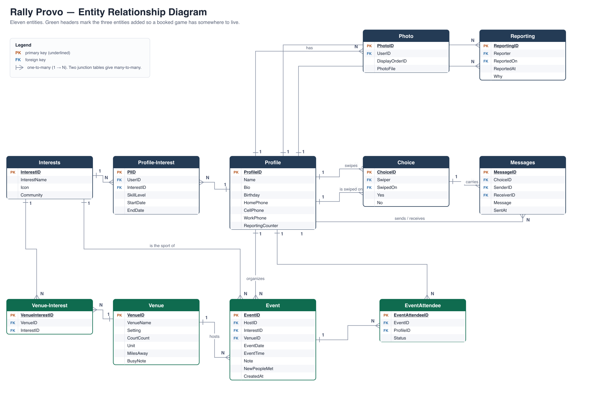

# Rally Provo

A sports-matching app for finding people to play with around Provo: swipe to match
players, chat, plan games, browse courts and reels, and track daily challenges and stats.

---

## App Summary

Moving to a new city, starting grad school, or just aging out of an old friend group
leaves a lot of people in Provo with the same problem: they want to play a sport, and
they have nobody to play it with. Pickup games exist, but finding one means knowing
somebody who already knows about it. The people most affected are students and recent
transplants — they have the time and the interest, but not yet the network. Rally Provo
solves this by treating pickup sports the way a dating app treats dating. You build a
profile with the sports you play, your skill level in each, and when you are usually
free, then swipe through other players nearby and match with the ones who line up. Once
two people match they can message each other, and from that conversation they can put a
real game on a shared calendar — a sport, a court, a date and a time. The app also
tracks the courts and fields around Provo, daily challenges to keep people playing, and
stats so you can see your streak and how many new people you have met. The result is
that a stranger in Provo can go from "I want to play pickleball" to a scheduled game
with a real person in a few minutes.

---

## ERD



Eleven entities. `Profile` is the hub — most other tables point back at it, several of
them twice (a report has both a reporter and a reported-on; a swipe has both a swiper
and a swiped-on). The three green entities were added so a booked game has somewhere to
live; everything else is the original dating-app model.

The diagram is generated from the live schema, so it cannot drift away from the database.
The source is `docs/erd.svg`.

| Entity | Purpose | Key attributes |
|---|---|---|
| **Profile** | A player | ProfileID (PK), Name, Bio, Birthday, HomePhone, CellPhone, WorkPhone, ReportingCounter |
| **Photo** | Profile pictures | PhotoID (PK), UserID (FK), DisplayOrderID, PhotoFile |
| **Interests** | A sport | InterestID (PK), InterestName, Icon, Community |
| **Profile-Interest** | Which sports a player plays, and how well | PIID (PK), UserID (FK), InterestID (FK), SkillLevel, StartDate, EndDate |
| **Choice** | One swipe decision | ChoiceID (PK), Swiper (FK), SwipedOn (FK), Yes, No |
| **Messages** | Chat between matched players | MessageID (PK), ChoiceID (FK), SenderID (FK), ReceiverID (FK), Message, SentAt |
| **Reporting** | Safety reports | ReportingID (PK), Reporter (FK), ReportedOn (FK), ReportedAt, Why |
| **Venue** | A court, park or field | VenueID (PK), VenueName, Setting, CourtCount, Unit, MilesAway, BusyNote |
| **Venue-Interest** | Which sports a venue supports | VenueInterestID (PK), VenueID (FK), InterestID (FK) |
| **Event** | A scheduled or played game | EventID (PK), HostID (FK), InterestID (FK), VenueID (FK), EventDate, EventTime, Note, NewPeopleMet, CreatedAt |
| **EventAttendee** | Who is playing in a game | EventAttendeeID (PK), EventID (FK), ProfileID (FK), Status |

### Relationships and cardinality

| Relationship | Cardinality |
|---|---|
| Profile → Photo | one-to-many (a player has many photos) |
| Profile ↔ Interests, through **Profile-Interest** | many-to-many (a player plays many sports; a sport has many players) |
| Profile → Choice, as *Swiper* | one-to-many |
| Profile → Choice, as *SwipedOn* | one-to-many |
| Choice → Messages | one-to-many (a match's conversation has many messages) |
| Profile → Messages, as *Sender* / *Receiver* | one-to-many each |
| Profile → Reporting, as *Reporter* / *ReportedOn* | one-to-many each |
| Venue ↔ Interests, through **Venue-Interest** | many-to-many (a court hosts several sports) |
| Profile → Event, as *Host* | one-to-many (a player organizes many games) |
| Interests → Event | one-to-many (every game is one sport) |
| Venue → Event | one-to-many (a court hosts many games) |
| Profile ↔ Event, through **EventAttendee** | many-to-many (a player joins many games; a game has many players) |

> **Note on naming.** Postgres folds unquoted identifiers to lower case, so `ProfileID`
> in the diagram is `profile_id` in the actual tables, `Profile-Interest` is
> `profile_interest`, and so on. The diagram and the database describe the same model.

---

## Tech Stack

| Layer | What we used | Why |
|---|---|---|
| Frontend | Plain HTML, CSS and vanilla JavaScript — no framework, no build step | The screens were already built this way. Adding a framework would have meant rewriting working UI to prove a database connection, which is not what this milestone is about. |
| Data access | [`@supabase/supabase-js`](https://supabase.com/docs/reference/javascript) loaded from a CDN | One `<script>` tag. No npm, no bundler, no `node_modules` for teammates to get out of sync. |
| Backend / API | Supabase (backend as a service) | Supabase hands us a REST API over our tables automatically, so there is no server code to write or host. |
| Database | Postgres, hosted by Supabase (free tier) | Real SQL with real foreign keys, so the ERD maps to actual constraints instead of being decorative. The table editor also lets every teammate *see* the rows, which made debugging much easier. |
| Security | Postgres row-level security (RLS) | Controls exactly what the public key is allowed to read and write. |
| Hosting | Opened locally, or any static file host | The app is four static files. |

**Why this stack fits our team.** Nobody on the team is a full-time backend developer, and
the assignment is graded on one button working end to end, not on infrastructure. A
hand-built Express/Node stack would have meant everybody installing Node, matching
versions, and running a server before they could see anything. Supabase gave us a real
Postgres database with a browsable table editor in about five minutes, and the frontend
talks to it directly. We still write real SQL and real schema, so we learned the data
modelling part — we just skipped the part where we maintain a server.

### About the API key

`config.js` is committed to the repository and contains the Supabase **publishable
(anon) key**. That is intentional and is how Supabase is designed to work: the
publishable key is meant to ship in frontend code, and it can only do what our
row-level security policies allow. Ours allow reading reference data and
creating/reading/deleting rows in `event` and `event_attendee` — nothing else.

The **`service_role` key**, which bypasses all security, is never committed and is not
in this repository. `.env` is listed in `.gitignore`. If you fork this project for real
use, add sign-in and tighten the RLS policies from `true` to `auth.uid()` checks.

---

## How to Get It Running

You need: a web browser, and Python 3 **or** Node (only to serve the files — either is
fine, and you probably already have one).

1. **Get the code.**
   ```
   git clone https://github.com/byeomans3/provo-pickup.git
   cd provo-pickup
   ```

2. **Check the config.** `config.js` is already in the repo with our class project's
   Supabase URL and publishable key, so there is nothing to fill in. It should look like:
   ```js
   window.RALLY_CONFIG = {
     SUPABASE_URL: 'https://....supabase.co',
     SUPABASE_ANON_KEY: 'sb_publishable_...',
   };
   ```
   If you are pointing this at **your own** Supabase project instead, copy
   `config.example.js` to `config.js` and put your own values in.

3. **Serve the folder.** The app loads the Supabase library over the network, so serve
   it rather than double-clicking `index.html`:
   ```
   python3 -m http.server 8000
   ```
   or
   ```
   npx serve .
   ```

4. **Open it.** Go to <http://localhost:8000>. You should land on the Home screen with
   players, courts and a calendar that already has games on it. Those games are coming
   from the database, not from your browser.

**If the calendar is empty** and you see "Could not reach the database", the Supabase
project is paused (free-tier projects sleep after inactivity). Open the project in the
Supabase dashboard and resume it, then refresh.

### Rebuilding the database from scratch

The schema and sample rows live in `db/schema.sql` and `db/seed.sql`. In a new Supabase
project, open **SQL Editor**, run `schema.sql`, then run `seed.sql`, then put that
project's URL and publishable key in `config.js`.

---

## Signing in

Every visitor lands on a **Log in / Sign up** screen first. Sign up takes an email and a
password (at least 6 characters); after that, Supabase Auth keeps the session in the
browser, so a returning player goes straight into the app until they choose **Log out**
on their profile.

- If the Supabase project has **Confirm email** turned on (the default), sign-up shows a
  "check your inbox" message and the player logs in after clicking the link. The link
  returns to the page they signed up from, so that URL must be listed under
  **Authentication → URL Configuration** in the Supabase dashboard.
- **New players set up a profile before they see the app:** a photo (required), first
  name, at least one sport with a skill level, an optional bio (up to 300 characters),
  and at least one time they are usually free. Photos are cropped to a 320px square in
  the browser. Players can change all of this later from **Your profile**.
- `auth.js` owns Supabase sign-up, sign-in, and sign-out. The profile adapter in `app.js`
  loads and saves the signed-in player's name, bio, sports/skill levels, availability,
  and photo. Photos are uploaded to the configured public-read Storage bucket and the
  resulting URL is stored in `photo.photo_file`. Set `PROFILE_PHOTO_BUCKET` in
  `config.js` to the bucket created by the database migration.
- The profile adapter depends on the database migration that adds `profile.auth_uid`,
  `current_profile_id()`, `profile_availability`, and owner-write policies, plus the
  profile-photo Storage bucket and `photo` write policy. The repository's base schema
  does not include those changes yet, so profile persistence is not end-to-end until
  the migration is merged and applied to Supabase. The existing sample calendar data
  remains attached to the demo `me` profile; new accounts start with an empty calendar.
- Other app data besides the calendar and profile is still local browser state or sample
  data and is not yet scoped to a Supabase account.

---

## Verifying the Vertical Slice

**The slice is: booking an event on the Calendar.** The button writes a row to Postgres,
reads it back, and redraws the calendar from the database.

What happens when you click Save:

1. The browser sends an `INSERT` to Supabase for the `event` table, and a second
   `INSERT` into `event_attendee` for you and whoever you are playing with.
2. Postgres writes the rows and returns the new `event_id`.
3. The app re-reads the games and redraws the calendar.
4. On every page load the app reads the events table again — which is why a refresh
   does not lose anything.

### Steps to verify

1. Open the app, sign up or log in, and click **Calendar** in the navigation.
2. Click **Add a game**.
3. Fill the form in — pick a sport, a court, **a date you will recognize**, and a time.
   Put something memorable in the Note field, like `TEST — delete me`.
4. Click **Save game**.
5. The modal closes, a confirmation toast appears, and the game shows up on that date in
   the calendar grid and in the day's list on the right.
6. **Refresh the page** (Cmd-R / Ctrl-R). Navigate back to Calendar. **The game is still
   there.**

### Proving it is really in the database, not the browser

A page refresh alone does not rule out browser storage, so there are two stronger checks:

- **Clear local storage.** Open the browser console and run `localStorage.clear()`, then
  refresh. The game is still on the calendar, because it is being read from Postgres.
- **Look at the row.** In the Supabase dashboard, open **Table Editor → `event`** and
  sort by `created_at` descending. Your new row is at the top, with the note you typed.
- **Open it somewhere else.** Load the same URL in a private window or on another
  device. The game is there too — which localStorage could never do.

To clean up, click the **✕** on the game in the calendar. That deletes the row from
Postgres (and the toast's **Undo** puts it back).

---

## What is live and what is not

Honest scope: this milestone moved **one** feature to the database.

| Feature | Where its data lives |
|---|---|
| **Calendar — book, view and cancel a game** | **Supabase Postgres** |
| Stats and streaks | Supabase Postgres (computed from the same events) |
| Profile, swiping, matches, messages, reels, challenges | Still `localStorage` |

The tables for the other features (`profile`, `choice`, `messages`, `photo`,
`reporting`, `profile_interest`) are built and seeded with sample data — the screens
just have not been pointed at them yet. Every one of those screens already goes through
the async `api` object in section 3 of `app.js`, so moving each one over is the same
small change we made for the calendar.

---

## Project structure

- `index.html` – page structure, navigation, modal and toast containers
- `styles.css` – all styling, with light and dark themes driven by CSS variables at the top
- `config.js` – Supabase URL and publishable key
- `config.example.js` – template for pointing the app at your own Supabase project
- `auth.js` – the log in / sign up screen; owns the shared Supabase client and holds the app back until someone is signed in
- `app.js` – data, logic and every screen
- `db/schema.sql` – the tables from the ERD
- `db/seed.sql` – sample rows for every table
- `docs/erd.png` – the diagram above (`docs/erd.svg` is the source, `docs/make_erd.py` regenerates both)

### How `app.js` is organized

1. **Helpers** – date formatting, escaping, icons
2. **Reference data** – sports, courts, sample players, challenges, reels
3. **Store + API** – the only place data is read or saved
4. **Supabase** – the database client and row mapping
5. **Illustrations** – court drawings used for cards and covers
6. **Navigation** – routing between screens (`#home`, `#play`, `#messages`, …)
7. **Views** – one render function per screen
8. **Modals, sheet, toast**
9. **Events** – one shared click, submit and keyboard handler
10. **Boot**

## Notes

- Players, courts and community numbers are sample data.
- Avatars are initials and reel covers are drawn court illustrations; swap in real photos
  and video once uploads exist.
- Fonts load from Google Fonts and fall back to system fonts offline.
