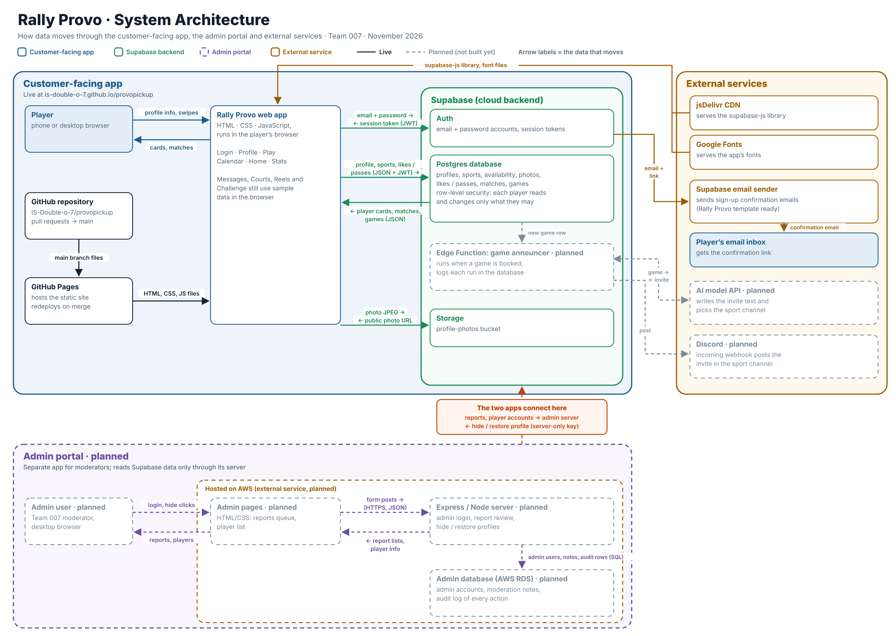
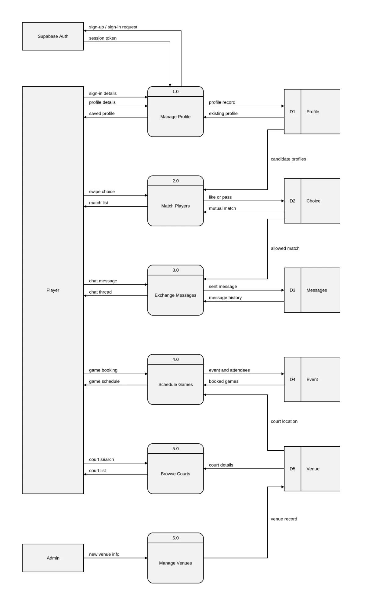
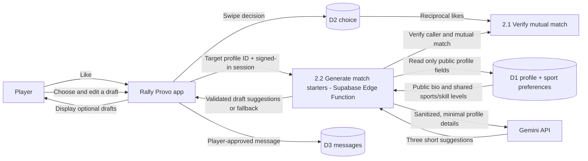
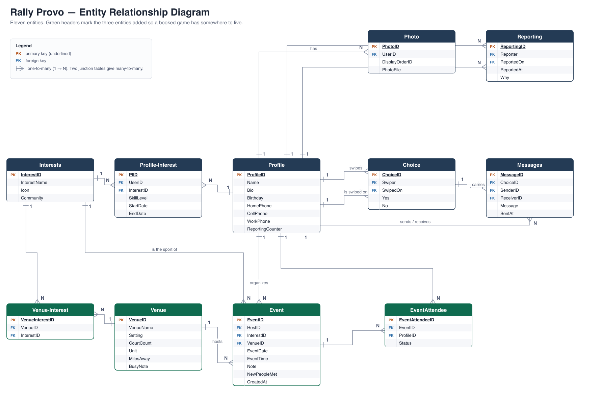

# Rally Provo

A sports-matching app for finding people to play with around Provo: swipe to match
players, chat, plan games, browse courts, and track daily challenges and stats.

**Live site:** <https://rallyprovo.com/> (GitHub Pages, deployed from `main`)

---

## App Summary

Moving to a new city, starting grad school, or just aging out of an old friend group
leaves a lot of people in Provo with the same problem: they want to play a sport, and
they have nobody to play it with. Pickup games exist, but finding one means knowing
somebody who already knows about it. The people most affected are students and recent
transplants — they have the time and the interest, but not yet the network. Rally Provo
solves this by treating pickup sports the way a dating app treats dating. You build a
profile with the sports you play, your skill level in each, and when you are usually
free, then swipe through other players nearby and match with the ones who line up. Once
two people match they can message each other, and from that conversation they can put a
real game on a shared calendar — a sport, a court, a date and a time. The app also
tracks the courts and fields around Provo, daily challenges to keep people playing, and
stats so you can see your streak and how many new people you have met. The result is
that a stranger in Provo can go from "I want to play pickleball" to a scheduled game
with a real person in a few minutes.

---

## Behavioral Requirements

What a user can do, and whether it works today. **Complete** means it was exercised end
to end (user → frontend → Supabase → back) and the result was checked; the Evidence
column says how. Anything that has not been checked that way is **Not complete**, even if
the code exists. Last reviewed October 30, 2026 against `main` and the live site.

### Login and profile

| # | Requirement | Status | Evidence |
|---|---|---|---|
| L1 | A visitor sees the Log in / Sign up page before anything else, until they are signed in | Complete | Live site; responsive check at 8 screen sizes (#16) |
| L2 | A new user can create an account with an email and a password (6+ characters) | Complete | A real account was created on the live site; it exists in Supabase Auth |
| L3 | A new account must confirm its email before first log-in, and the link returns to the site | Complete | Verified on the live site 2026-11-03. Site URL and redirect URLs now point at GitHub Pages; a real sign-up confirmed in 12s and landed signed in at the profile setup step |
| L4 | A returning user can log in, and stays signed in after a reload | Complete | Live site, Brook's account (Oct 30) |
| L5 | A new user must create a profile before using the app: photo, first name, at least one sport with a skill level, at least one availability slot; bio optional | Complete | Live: the account's profile, sport, availability and photo rows exist in Supabase; photo loads from Storage (200, image/jpeg) |
| L6 | A user who already has a profile goes straight to the app on log-in | Complete | Live site, Brook's account; 4 login cases tested in #13 |
| L7 | A user can edit their photo, name, sports, bio and availability from **Your profile** | Not complete | Works against a stand-in database (#5, #9); not yet checked live |
| L8 | Log out always returns to the login page | Not complete | Tested against a stand-in, including a failed sign-out request (#15); not yet checked live |
| L9 | Phone numbers and birthdays are visible only to their owner | Complete | Live database: a signed-out client reads 0 rows from `profile_private` and cannot read `auth_uid` (#8, #11) |
| L10 | A user cannot create or change another user's profile | Complete | Live database: an update against another profile changes 0 rows; a second profile per account is rejected (#7) |
| L11 | A player can permanently delete their profile and login from **Your profile** (type DELETE to confirm) | Not complete | Works against a stand-in database: profile, photo, sports, availability, swipes and login removed, old password rejected. Needs migration 009 applied, then a live check |
| L12 | Players must be 18 or older: profile setup requires a birthday, and anyone under 18 can't finish it or change their birthday to under 18 | Not complete | Front end done (#61): tested 'turns 18 tomorrow' (refused, nothing saved) and 'turns 18 today' (allowed). Accounts made earlier get an 'Add birthday' reminder. A database check for 18+ is still to come (#7, Jordan) |

### Matching (Play page)

| # | Requirement | Status | Evidence |
|---|---|---|---|
| M1 | The deck shows other players with name, photo (or initials), bio, sports with levels, and availability; no age, distance or home court | Complete | Live site, Brook's account |
| M2 | A user never sees themselves or the demo "You" profile in the deck | Complete | Fixed in #17 and confirmed live |
| M3 | Like and pass are saved, and that player does not come back after a reload | Complete | Live: 10 likes and a pass saved as `choice` rows |
| M4 | **Undo** right after a pass brings that player back | Complete | Live: the pass row was deleted and the card returned |
| M5 | **Review passed players** brings back everyone passed, and keeps likes | Complete | Live: passes deleted, all 10 likes kept |
| M6 | A match appears only when both players like each other, and shows in **Your matches** | Not complete | Verified on the live database (#7) and against a stand-in with two accounts (#10); not yet seen in the live app, which needs a second real account |
| M7 | A player cannot see who has liked them until it is a match | Complete | Live database: another account reads 0 rows from `choice` (#7) |
| M8 | Filter the deck by sport | Not complete | In the UI; not yet checked against live data |

### Other pages and course requirements

| # | Requirement | Status | Evidence |
|---|---|---|---|
| C1 | Book, view and cancel a game on the Calendar, saved in Postgres | Complete | Calendar vertical slice (#1) |
| C2 | Games belong to the signed-in player (a new account starts with an empty calendar) | Complete | Front end in #66; migration 019 applied to the live project on 2026-11-15 so the database refuses other players too, not only the screen. Re-tested as a signed-in player: booking, adding both players and logging a past game all work; another player cancelling is refused (0 rows) and claiming someone else as host is refused (`42501`) |
| C3 | New games can only be scheduled for a future date and time (up to a year ahead) | Complete | #55: picker limits plus a save check in local time; tested yesterday, earlier today and 400 days out (all refused) and tomorrow (saved) |
| C4 | After a game's start time, players can add or edit its result: score, new people met, a short note | Complete | Front end in #65; migration 016 applied to the live project. The update rule is limited to played games and to those three columns, with column-level grants under it |
| C5 | The Rally Provo logo takes a signed-in player to Home | Complete | Logo in the sidebar and the phone top bar is a link to Home; tested on desktop and mobile |
| X1 | Message a match (chat saved in the database) | Complete | #39: messages saved in Postgres, only to mutual matches, unread badge clears when read; two-player test passed |
| X2 | Courts and Maps pages read venues from the database | Complete | #39: Courts reads `venue` and `venue_interest` instead of the hardcoded list. #69 adds the map itself: a pin per court drawn from `venue.latitude` / `longitude`, filtered by the same sport chips as the list, with a popup that opens that court's details. #53 lets a signed-in player add a court, geocoded from a typed address |
| X3 | Every page scores 90+ in Lighthouse Accessibility | Not complete | **No official Lighthouse run yet** -- it needs Chrome's profiler on a signed-in page. An automated check of the same axe rules across all eight pages, light and dark, now finds nothing: labels, control names, alt text, landmarks, `lang`, viewport, duplicate ids, tab order, list structure and colour contrast all pass. The heading-order skips on Home, Stats and Admin were the last rule still failing and were fixed in #51 |
| X4 | Every page is responsive on desktop and mobile | Not complete | Checked at 8 screen sizes (320 to 1920 wide, plus phone landscape) with no sideways scroll, clipping or undersized buttons: Log in, Sign up, Profile setup, Play, Messages (list and open chat), Calendar (month and Add game form), Courts (list and court details). Home, Challenge and Stats not checked yet |
| X5 | An AI automation connected to an external service | In progress | The `match-starters` Supabase Edge Function verifies mutual matches and can request personalized conversation starters from Gemini. Deploy the function and configure `GEMINI_API_KEY` to enable the external AI call; the app uses fallback suggestions when Gemini is unavailable |
| X6 | The four Key Results update automatically from user activity | Complete | `okr_dashboard()` (migrations 012 and 018) computes all four from live rows and is admin-only; the Admin page shows them and refreshes every 30 seconds (#51). Nothing is stored or hand-entered. See **OKR tracking** below for each formula and its source table |
| X7 | Admin portal | Partly complete | The admin **page** is live (#51): an allow-list in `admin_user`, enforced by `is_admin()` in the database rather than by hiding the tab, showing the four Key Results and players by age band (counts only -- no birthdays, names or phone numbers). **Moderation is not built:** reading reports and removing a player, which the Trello card asks for, do not exist |
| X8 | The site is live at a real URL anyone can open | Complete | <https://rallyprovo.com/>; redeploys on every merge to `main` |

---

## OKR tracking

The four Key Results the team set at Sprint 1 planning are **computed from live rows
every time the Admin page loads**, and the page refreshes itself every 30 seconds.
Nothing is stored, cached or typed in by hand -- there is no table of saved figures to
go stale, so a number can only change by someone using the app.

One database function does all four: `public.okr_dashboard()`, added in migration 012
and revised in migration 018. It is `security definer` with `set search_path = ''`,
raises `42501` unless `is_admin()` passes, and **returns counts only** -- never a
birthday, name, phone number or any other personal field. `execute` is revoked from
`public` and `anon`.

Only real accounts count: a profile is included only when its `auth_uid` is set, so the
seeded demo profiles never inflate a figure. "Last 7 days" is a rolling window in Provo
time (`America/Denver`).

| # | Key Result | Tables it reads | Formula |
|---|---|---|---|
| 1 | Share of players with a complete profile | `profile`, `profile_private`, `photo` | players with a non-blank `name`, a `birthday`, and at least one `photo` row whose `photo_file` is non-blank ÷ all players |
| 2 | Share of players who played in the last 7 days | `event`, `event_attendee` | **distinct** `event_attendee.profile_id` on events whose `event_date` falls in the last 7 days ÷ all players. Distinct players, not attendance rows -- one game with two players used to report 2 |
| 3 | Mutual matches made in the last 7 days | `choice` | pairs where both directions have `yes = true`, dated by `greatest()` of the two `created_at` values, counted when that date is inside the window. `greatest()` ignores NULLs, so a pair with one old NULL and one recent like dates from the recent one -- which is right, because every NULL predates migration 012 |
| 4 | Share of matched pairs who have messaged | `choice`, `messages` | matched pairs with at least one `messages` row in either direction ÷ all matched pairs |

A game played today counts from tomorrow, because the window is whole days, so Key
Result 2 trails real activity by up to a day.

**What the figures mean when they read low.** They are honest counts, not targets. If
most players have not added a birthday or a photo, Key Result 1 says so. The
requirement these satisfy is that each number moves on its own when somebody uses the
app -- not that it reaches 100%.

**Players by age** on the same page comes from `age_bands()` (migration 017), which is
also admin-only and also counts only. Rally Provo is 18+, enforced by a trigger on
`profile_private`, so there is no under-18 band.

## System Architecture



Solid lines are live; dashed lines are planned. Each arrow is labeled with the data it
carries. The source is `docs/architecture.svg`.

- **Customer-facing app (live):** a static HTML/CSS/JavaScript web app hosted on GitHub
  Pages, using Supabase for logins (Auth), data (Postgres with row-level security) and
  profile photos (Storage).
- **Admin page (live):** a page inside the same app, not a separate portal. Access is an
  allow-list table (`admin_user`) checked by `is_admin()` in the database, so hiding the
  tab is a convenience and never the protection. It shows the four Key Results and
  players by age band, both through `security definer` functions that return counts
  only. No service-role key is involved and none is in browser code.
- **Moderation (planned):** reading reports and hiding or restoring a player. Not built.
  The earlier plan for a separate Express/Node server on AWS with its own database was
  not adopted; if moderation is built it belongs in this page, behind the same
  allow-list.
- **External services:** jsDelivr, cdnjs and Google Fonts (code libraries and
  fonts), Supabase's email sender (confirmation link), and OpenStreetMap — both
  its Nominatim geocoder and its map tiles — are live. **The Courts map is
  Leaflet 1.9.4 with OpenStreetMap tiles. There is no Google Maps key and none
  is needed: no API key, no account, no billing and no quota to manage.** The
  map needs no configuration — it works from a clean clone. If the tiles cannot
  be reached the map says so and the court list carries on working. Nominatim turns the address typed into "Add a court" into
  map coordinates; it is free, needs no key, and was approved by the Product
  Owner on PR #53. It is called only when a player submits the form, which keeps
  us inside Nominatim's usage policy of about one request a second. On a mutual match, the
  `match-starters` Supabase Edge Function verifies that the signed-in player and target
  still have a reciprocal like. It reads only public bios and sport/skill preferences,
  removes recognizable age, contact and location details from bio text, and asks Gemini
  for three optional conversation starters. The app shows them as drafts; a player must
  choose and can edit one before sending through the existing Messages flow. The Gemini
  key is a Supabase Function secret and never appears in browser code. If Gemini is not
  configured or returns an error, the app shows non-AI fallback starters.

---

## Data Flow Diagram



Yourdon/DeMarco notation: rectangles are external entities, numbered circles are
processes, and the open-ended boxes on the right are data stores. Every arrow is
labeled with the data it carries. The Level 0 context diagram is kept alongside it in
Lucidchart and is not exported here yet.

| Process | What it does | Data store |
|---|---|---|
| 1.0 Manage Profile | Sign-in, sign-up and profile editing | D1 `profile` |
| 2.0 Match Players | Swipe, like/pass, mutual match | D2 `choice` |
| 3.0 Exchange Messages | Chat between matched players | D3 `messages` |
| 4.0 Schedule Games | Book, cancel and restore games | D4 `event` / `event_attendee` |
| 5.0 Browse Courts | Court search and listings | D5 `venue` |
| 6.0 Manage Venues | Adding and editing courts (**planned**) | D5 `venue` |

### AI workflow: match conversation starters

This Level 1 process runs only after a mutual like. The Edge Function independently
checks the authenticated user's match through `current_profile_id()` and `my_matches()`;
it does not trust a client-supplied match claim. No age, location, contact, photo,
availability, or account identifier is sent to Gemini. Profile bios are user-written
and are filtered for recognizable age/location/contact details before use. Suggestions
are drafts only; choosing one opens Messages with the text in the composer, and the
player decides whether to edit or send it.



To enable Gemini, set `GEMINI_API_KEY` as a Supabase Edge Function secret, then deploy
`match-starters` (`supabase functions deploy match-starters`). The optional
`GEMINI_MODEL` secret selects a supported Gemini model; the default is `gemini-3.8-flash`.
Without a key, the function returns fallback starters and matching still works.
Never put the Gemini key in `config.js`, browser code, Git, or chat. Check the current
[Gemini API pricing and free-tier limits](https://ai.google.dev/gemini-api/docs/pricing)
before choosing a model; free-tier terms and availability can change.

A DFD shows the designed flow, not what is built today. Right now only **4.0 Schedule
Games** is backed by the database end to end. Processes 1.0, 2.0, 3.0 and 5.0 run on
browser state or sample data — the tables exist, and the messaging wiring is waiting in
PR #39. **6.0 Manage Venues** belongs to the planned admin portal described above; there
is no add-court screen in the app today.

---

## ERD



Thirteen entities. `Profile` is the hub — most other tables point back at it, several of
them twice (a report has both a reporter and a reported-on; a swipe has both a swiper
and a swiped-on). The three green entities were added so a booked game has somewhere to
live; everything else is the original dating-app model.

> **The diagram above is out of date.** It still shows the pre-authentication model.
> Migration `db/migrations/001_auth_profiles_photos_matching.sql` added
> `profile_private` and `profile_availability`, added `Profile.AuthUID`, and moved
> `Birthday`, `HomePhone`, `CellPhone`, `WorkPhone` and `ReportingCounter` out of
> `Profile` into `profile_private`. Regenerate with `python3 docs/make_erd.py`, which
> writes `docs/erd.svg`; `docs/erd.png` is exported from that SVG by hand.

### Profile, private fields and availability

A real account maps to its profile through `profile.auth_uid`, which references
`auth.users(id)`. The primary key stays the text `profile_id`, so the eleven seed
profiles, the six foreign keys pointing at them and the existing calendar rows all keep
working; seed profiles simply have a null `auth_uid` and nobody can claim them.

`profile` itself now holds only what another player is allowed to see — `profile_id`,
`name`, `bio` and `auth_uid`. Contact details and the moderation counter live in
`profile_private`, which only the owner can read. `profile_availability` stores one row
per free time slot, drawn from the same eight slots the UI offers.

Two helper functions back the policies: `current_profile_id()` resolves the signed-in
user to their `profile_id`, and `my_matches()` returns the profiles that have liked you
back. Both are `SECURITY DEFINER` — the first because a policy on `profile` that queried
`profile` would recurse, the second so a match can be confirmed without exposing a
like that has not been reciprocated.

The diagram is generated from the live schema, so it cannot drift away from the database.
The source is `docs/erd.svg`.

| Entity | Purpose | Key attributes |
|---|---|---|
| **Profile** | A player | ProfileID (PK), Name, Bio, Birthday, HomePhone, CellPhone, WorkPhone, ReportingCounter |
| **Photo** | Profile pictures | PhotoID (PK), UserID (FK), DisplayOrderID, PhotoFile |
| **Interests** | A sport | InterestID (PK), InterestName, Icon, Community |
| **Profile-Interest** | Which sports a player plays, and how well | PIID (PK), UserID (FK), InterestID (FK), SkillLevel, StartDate, EndDate |
| **Choice** | One swipe decision | ChoiceID (PK), Swiper (FK), SwipedOn (FK), Yes, No |
| **Messages** | Chat between matched players | MessageID (PK), ChoiceID (FK), SenderID (FK), ReceiverID (FK), Message, SentAt |
| **Reporting** | Safety reports | ReportingID (PK), Reporter (FK), ReportedOn (FK), ReportedAt, Why |
| **Venue** | A court, park or field | VenueID (PK), VenueName, Setting, CourtCount, Unit, MilesAway, BusyNote, Latitude, Longitude |
| **Venue-Interest** | Which sports a venue supports | VenueInterestID (PK), VenueID (FK), InterestID (FK) |
| **Event** | A scheduled or played game | EventID (PK), HostID (FK), InterestID (FK), VenueID (FK), EventDate, EventTime, Note, NewPeopleMet, Score (016), CreatedAt |
| **EventAttendee** | Who is playing in a game | EventAttendeeID (PK), EventID (FK), ProfileID (FK), Status |

### Relationships and cardinality

| Relationship | Cardinality |
|---|---|
| Profile → Photo | one-to-many (a player has many photos) |
| Profile ↔ Interests, through **Profile-Interest** | many-to-many (a player plays many sports; a sport has many players) |
| Profile → Choice, as *Swiper* | one-to-many |
| Profile → Choice, as *SwipedOn* | one-to-many |
| Choice → Messages | one-to-many (a match's conversation has many messages) |
| Profile → Messages, as *Sender* / *Receiver* | one-to-many each |
| Profile → Reporting, as *Reporter* / *ReportedOn* | one-to-many each |
| Venue ↔ Interests, through **Venue-Interest** | many-to-many (a court hosts several sports) |
| Profile → Event, as *Host* | one-to-many (a player organizes many games) |
| Interests → Event | one-to-many (every game is one sport) |
| Venue → Event | one-to-many (a court hosts many games) |
| Profile ↔ Event, through **EventAttendee** | many-to-many (a player joins many games; a game has many players) |

> **Note on naming.** Postgres folds unquoted identifiers to lower case, so `ProfileID`
> in the diagram is `profile_id` in the actual tables, `Profile-Interest` is
> `profile_interest`, and so on. The diagram and the database describe the same model.

---

## Tech Stack

| Layer | What we used | Why |
|---|---|---|
| Frontend | Plain HTML, CSS and vanilla JavaScript — no framework, no build step | The screens were already built this way. Adding a framework would have meant rewriting working UI to prove a database connection, which is not what this milestone is about. |
| Data access | [`@supabase/supabase-js`](https://supabase.com/docs/reference/javascript) loaded from a CDN | One `<script>` tag. No npm, no bundler, no `node_modules` for teammates to get out of sync. |
| Backend / API | Supabase (backend as a service) | Supabase hands us a REST API over our tables automatically, so there is no server code to write or host. |
| Database | Postgres, hosted by Supabase (free tier) | Real SQL with real foreign keys, so the ERD maps to actual constraints instead of being decorative. The table editor also lets every teammate *see* the rows, which made debugging much easier. |
| Security | Postgres row-level security (RLS) | Controls exactly what the public key is allowed to read and write. |
| Hosting | GitHub Pages, deployed from `main` | The app is static files, so there is nothing to build; every merge to `main` is live at <https://rallyprovo.com/> within a minute or two. |

**Why this stack fits our team.** Nobody on the team is a full-time backend developer, and
the assignment is graded on one button working end to end, not on infrastructure. A
hand-built Express/Node stack would have meant everybody installing Node, matching
versions, and running a server before they could see anything. Supabase gave us a real
Postgres database with a browsable table editor in about five minutes, and the frontend
talks to it directly. We still write real SQL and real schema, so we learned the data
modelling part — we just skipped the part where we maintain a server.

### About the API key

`config.js` is committed to the repository and contains the Supabase **publishable
(anon) key**. That is intentional and is how Supabase is designed to work: the
publishable key is meant to ship in frontend code, and it can only do what our
row-level security policies allow. Anyone may read the public profile columns
(`profile_id`, `name`, `bio`), sports, availability, photos and reference data. A
signed-in player may write only their own profile, sports, availability, photo and
swipes, and may send a message only as themselves and only to a confirmed mutual
match. Private contact details, swipes, messages and reports are readable only by
their owner. The calendar's `event` and `event_attendee` may be read by anyone, and
**any signed-in player may still book or cancel any game** — a known, open gap.
Migration 010 scoped those writes to the game's host, but migration 011 reverted it:
the app books every game as the shared placeholder `me`, so the owner-only rule
refused every booking on the live site. Ownership scoping returns together with the
front-end fix (PR #42). Whether the calendar should stay publicly readable has not
been decided (Issues #21 and #41), so reads are deliberately still open.

The **`service_role` key**, which bypasses all security, is never committed and is not
in this repository. `.env` is listed in `.gitignore`.

---

## How to Get It Running

You need: a web browser, and Python 3 **or** Node (only to serve the files — either is
fine, and you probably already have one).

1. **Get the code.**
   ```
   git clone https://github.com/IS-Double-o-7/provopickup.git
   cd provopickup
   ```

2. **Check the config.** `config.js` is already in the repo with our class project's
   Supabase URL and publishable key, so there is nothing to fill in. It should look like:
   ```js
   window.RALLY_CONFIG = {
     SUPABASE_URL: 'https://....supabase.co',
     SUPABASE_ANON_KEY: 'sb_publishable_...',
   };
   ```
   If you are pointing this at **your own** Supabase project instead, copy
   `config.example.js` to `config.js` and put your own values in.

3. **Serve the folder.** The app loads the Supabase library over the network, so serve
   it rather than double-clicking `index.html`:
   ```
   python3 -m http.server 8000
   ```
   or
   ```
   npx serve .
   ```

4. **Open it.** Go to <http://localhost:8000>. You land on the Log in / Sign up page;
   after signing in (and setting up your profile the first time) you reach the Home
   screen. You don't need to run it locally just to use or test the app: the live site
   is <https://rallyprovo.com/>.

**If the calendar is empty** and you see "Could not reach the database", the Supabase
project is paused (free-tier projects sleep after inactivity). Open the project in the
Supabase dashboard and resume it, then refresh.

### Rebuilding the database from scratch

The schema and sample rows live in `db/schema.sql` and `db/seed.sql`. In a new Supabase
project, open **SQL Editor**, run `schema.sql`, then run `seed.sql`, then put that
project's URL and publishable key in `config.js`.

`db/schema.sql` is always the current shape of the database, so a fresh project needs
only that file. `db/migrations/` holds the changes that brought an *existing* database up
to it — run a migration only against a project created before it. Migration 001 moves
data (contact columns out of `profile`), so take a backup before applying it to a
database with real rows in it.

Profile photos need a Storage bucket named `profile-photos`, which `schema.sql` and the
migration both create. Objects are stored at `<auth.uid()>/<filename>`: public to read,
writable only by the user who owns that folder.

---

## Signing in

Every visitor lands on a **Log in / Sign up** screen first. Sign up takes an email and a
password (at least 6 characters); after that, Supabase Auth keeps the session in the
browser, so a returning player goes straight into the app until they choose **Log out**
on their profile.

- If the Supabase project has **Confirm email** turned on (the default), sign-up shows a
  "check your inbox" message and the player logs in after clicking the link. The link
  returns to the page they signed up from, so that URL must be listed under
  **Authentication → URL Configuration** in the Supabase dashboard.
- **New players set up a profile before they see the app:** a photo (required), first
  name, at least one sport with a skill level, an optional bio (up to 300 characters),
  and at least one time they are usually free. Photos are cropped to a 320px square in
  the browser. Players can change all of this later from **Your profile**.
- **A player who already has a profile goes straight to the app** on log-in. A profile
  that was saved only in the browser (before profiles moved to Supabase) is copied to
  the database automatically, and a profile missing a field shows a **Finish profile**
  prompt instead of the setup page.
- **Log out** is in **Your profile** and always returns to the login page, even if the
  sign-out request to Supabase fails.
- `auth.js` owns Supabase sign-up, sign-in and sign-out. The profile adapter in `app.js`
  loads and saves the signed-in player's name, bio, sports and skill levels,
  availability and photo. Photos are uploaded to the public-read Storage bucket
  `profile-photos` at `<auth.uid()>/profile.jpg`, and the URL is stored in
  `photo.photo_file`.
- The adapter finds the signed-in player's row with `current_profile_id()`; it never
  selects `auth_uid`, which signed-out clients cannot read. Migrations 001 (#8) and the
  column-privacy fix (#11) are applied to the live Supabase project.
  Migration 007 widens availability to mornings, afternoons and evenings on every day
  (21 slots); it must be applied before the profile page that offers them goes live.
  Migration 009 adds `delete_my_account()`, the server-side function behind **Delete
  profile**; it must be applied before that button works on the live site.
- The sample calendar data stays attached to the demo `me` profile.

---

## Verifying the Vertical Slice

**The slice is: booking an event on the Calendar.** The button writes a row to Postgres,
reads it back, and redraws the calendar from the database.

What happens when you click Save:

1. The browser sends an `INSERT` to Supabase for the `event` table, and a second
   `INSERT` into `event_attendee` for you and whoever you are playing with.
2. Postgres writes the rows and returns the new `event_id`.
3. The app re-reads the games and redraws the calendar.
4. On every page load the app reads the events table again — which is why a refresh
   does not lose anything.

### Steps to verify

1. Open the app, sign up or log in, and click **Calendar** in the navigation.
2. Click **Add a game**.
3. Fill the form in — pick a sport, a court, **a date you will recognize**, and a time.
   Put something memorable in the Note field, like `TEST — delete me`.
4. Click **Save game**.
5. The modal closes, a confirmation toast appears, and the game shows up on that date in
   the calendar grid and in the day's list on the right.
6. **Refresh the page** (Cmd-R / Ctrl-R). Navigate back to Calendar. **The game is still
   there.**

### Proving it is really in the database, not the browser

A page refresh alone does not rule out browser storage, so there are two stronger checks:

- **Clear local storage.** Open the browser console and run `localStorage.clear()`, then
  refresh. The game is still on the calendar, because it is being read from Postgres.
- **Look at the row.** In the Supabase dashboard, open **Table Editor → `event`** and
  sort by `created_at` descending. Your new row is at the top, with the note you typed.
- **Open it somewhere else.** Load the same URL in a private window or on another
  device. The game is there too — which localStorage could never do.

To clean up, click the **✕** on the game in the calendar. That deletes the row from
Postgres (and the toast's **Undo** puts it back).

---

## What is live and what is not

| Feature | Where its data lives |
|---|---|
| **Accounts, sign-in and sign-out** | **Supabase Auth** |
| **Profile: name, bio, sports and levels, availability, photo** | **Supabase Postgres and Storage**, one profile per account |
| **Play: deck, likes, passes, undo, matches** | **Supabase Postgres** (`choice`, `my_matches()`) |
| **Calendar: book, view and cancel a game, log a result** | **Supabase Postgres**, owned by the signed-in account and enforced there (migrations 016 and 019) |
| **Messages** | **Supabase Postgres** (`messages`), mutual matches only |
| **Courts and the map** | **Supabase Postgres** (`venue`, `venue_interest`); the map is Leaflet with OpenStreetMap tiles |
| **Admin page: the four Key Results, players by age** | **Supabase Postgres**, counts only, admin-only (`okr_dashboard()`, `age_bands()`) |
| Stats and streaks | Computed in the browser from the same calendar events |
| Challenges | Still browser `localStorage` |

See **Behavioral Requirements** above for what has been checked end to end.

---

## Project structure

- `index.html` – page structure, navigation, modal and toast containers
- `styles.css` – all styling, with light and dark themes driven by CSS variables at the top
- `config.js` – Supabase URL and publishable key
- `config.example.js` – template for pointing the app at your own Supabase project
- `auth.js` – the log in / sign up screen; owns the shared Supabase client and holds the app back until someone is signed in
- `app.js` – data, logic and every screen
- `supabase/functions/match-starters/index.ts` – authenticated, mutual-match-only Gemini starter generation
- `db/schema.sql` – the tables from the ERD
- `db/seed.sql` – sample rows for every table
- `docs/erd.png` – the ERD above (`docs/erd.svg` is the source, `docs/make_erd.py` regenerates both)
- `docs/dfd-level1.png` – the level 1 data flow diagram above (source lives in Lucidchart)
- `docs/dfd-prompt.md` – the prompts used to generate the data flow diagrams

### Bump the asset version when you change the front end

`index.html` loads the local assets with a version string:

```html
<link rel="stylesheet" href="styles.css?v=2026-11-06">
<script src="app.js?v=2026-11-06"></script>
```

**If you change `styles.css`, `config.js`, `auth.js` or `app.js`, bump every `?v=` in
`index.html` in the same commit.** Use the date, adding `-2`, `-3` and so on for later
deploys the same day.

This is not decoration. GitHub Pages serves every file with `Cache-Control: max-age=600`
and no shared cache key, so `index.html`, `styles.css` and `app.js` each expire on their
own ten-minute clock. A returning browser can therefore load a **new `index.html`
against a stale `styles.css`**. That combination does not fail loudly — it renders the
weekly availability grid as scrambled boxes, because `.week` is defined twice (the
challenge streak strip uses a 7-column version, the availability grid a 4-column one)
and the old stylesheet only has the first. Changing the version string gives the browser
a URL it has never seen, so the HTML and its assets always arrive as a matched set.

If you are testing the live site and something looks wrong, hard-refresh
(`Cmd+Shift+R` / `Ctrl+Shift+R`) before reporting it.

### How `app.js` is organized

1. **Helpers** – date formatting, escaping, icons
2. **Reference data** – sports, courts, sample players, challenges
3. **Store + API** – the only place data is read or saved
4. **Supabase** – the database client and row mapping
5. **Illustrations** – court drawings used for cards and covers
6. **Navigation** – routing between screens (`#home`, `#play`, `#messages`, …)
7. **Views** – one render function per screen
8. **Modals, sheet, toast**
9. **Events** – one shared click, submit and keyboard handler
10. **Boot**

## Notes

- Players, courts and community numbers are sample data.
- Players' profile photos are real uploads. Demo players without a photo show initials.
- Fonts load from Google Fonts and fall back to system fonts offline.
